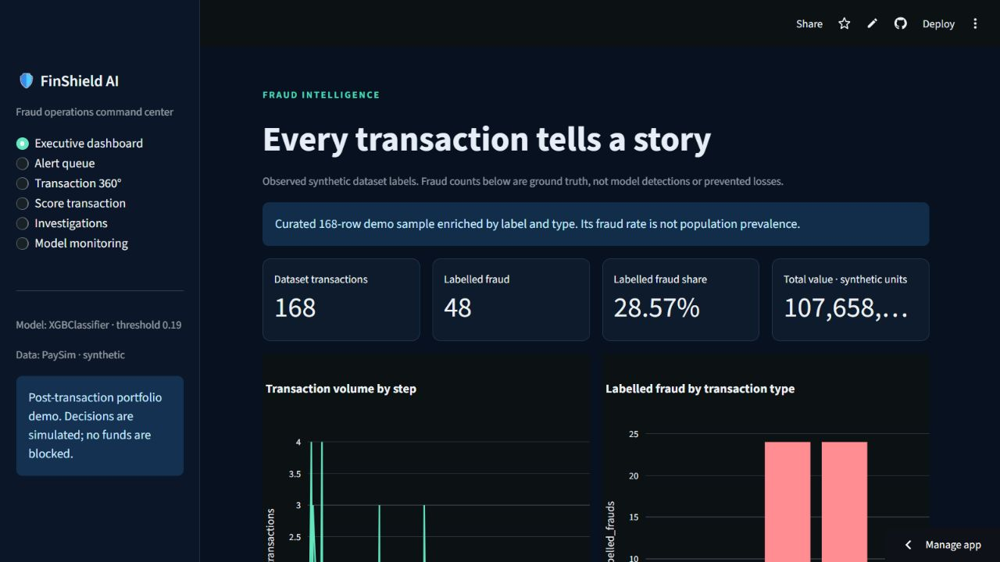

# Working Model — FinShield AI

## Open the live application

**[Launch FinShield AI on Streamlit](https://sanchay-finshield-ai.streamlit.app/)**

The app opens directly in a browser. No installation, API key or sign-in is needed. If inactive hosting has put it to sleep, allow it to wake up.

## What to explore

| Workspace | What it demonstrates |
|---|---|
| Executive dashboard | Transaction-volume charts, observed sample labels and historical model comparison |
| Alert queue | Scored transactions and risk-based investigation prioritization |
| Transaction 360° | Model explanations, account history, related transactions and policy evidence |
| Score transaction | Live inference for custom transaction amounts, types and balances |
| Investigations | Simulated case assignment, workflow, notes and dispositions |
| Model monitoring | Demo prediction telemetry and model monitoring views |

## Data and interpretation

The hosted dashboard uses the repository's **168-row curated synthetic PaySim sample** and included trained model. This sample is deliberately enriched by fraud label and transaction type; its fraud rate is not population prevalence. It is an educational, post-transaction portfolio demonstration. Model probabilities are uncalibrated; risk scores and simulated decisions do not establish fraud, and no funds are moved or blocked.

Case notes and telemetry are shared demo state and may reset on hosting restart. Use sample information only. The app does not need a private database or live OpenAI calls. Its local grounded copilot retrieves the included policy evidence without an API key.

## Technical review

- [Streamlit dashboard](dashboard/app.py)
- [Scoring service](api/service.py)
- [Feature engineering](src/features/fraud_features.py)
- [SHAP explanation](src/investigation/risk_explanation.py)
- [Policy and behavioral rules](src/rules)
- [Model card](docs/model_card.md)
- [Deployment instructions](docs/deployment.md)
- [Automated tests](tests)

Deployment validation: **50 tests passed; one PostgreSQL integration test skipped locally** because `TEST_DATABASE_URL` was not configured. All six Streamlit routes were exercised locally, including transaction scoring in the test suite. These checks do not establish real-world fraud-detection performance.
