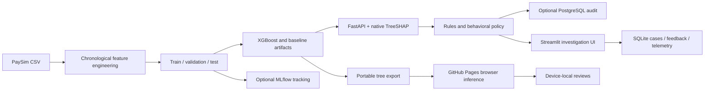

# Architecture

The Streamlit scorer calls the Python service in-process. The separately runnable FastAPI server exposes the same service; Streamlit does not require an HTTP hop to score. PostgreSQL ingestion is a separate workflow for raw data and SQL analysis.

The public browser demo runs the exported model with the same transaction features and cold-start history defaults as the API. Native XGBoost/JavaScript probabilities are parity-tested on every supplied fixture. Python generates SHAP for those fixtures, while custom browser inputs show only rule evidence. Full custom TreeSHAP is available through Python.

Risk recommendations are simulated, not payment actions. Model probability, classifier threshold, combined risk score, and policy bands are distinct concepts.
